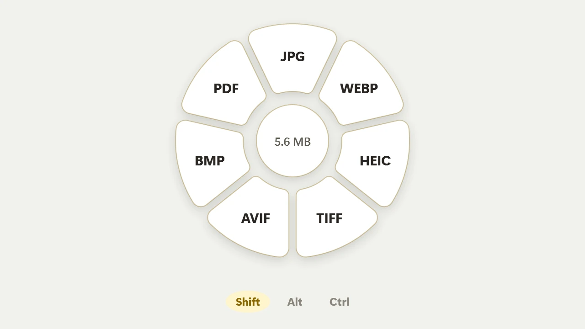
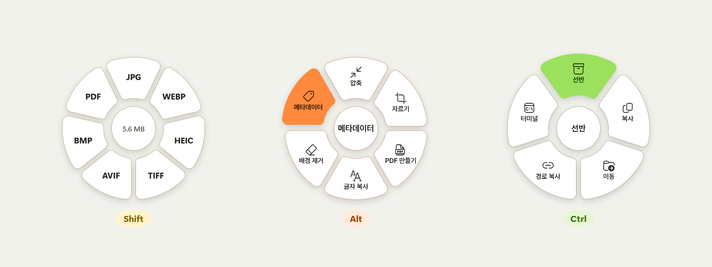

<p align="center">
  <picture><source media="(prefers-color-scheme: dark)" srcset="docs/images/header-en-dark.png" /></picture>
</p>

<p align="center">
  <a href="README.md">한국어</a> · <b>English</b>
</p>

<p align="center">
  <picture><source media="(prefers-color-scheme: dark)" srcset="https://shieldcn.dev/badge/Windows-10_%7C_11.svg?logo=lu:AppWindow&amp;variant=secondary&amp;size=sm&amp;mode=dark" /></picture>
  <picture><source media="(prefers-color-scheme: dark)" srcset="https://shieldcn.dev/badge/.NET-10.svg?logo=dotnet&amp;variant=secondary&amp;size=sm&amp;mode=dark" /></picture>
  <a href="LICENSE"><picture><source media="(prefers-color-scheme: dark)" srcset="https://shieldcn.dev/badge/License-MIT.svg?logo=lu:Scale&amp;variant=secondary&amp;size=sm&amp;mode=dark" /></picture></a>
</p>

<div align="center">

**Zest** is a Windows tray app: tap a key once while you drag a file in Explorer and a wheel opens, so dropping the file on a petal changes its format, opens a tool or moves it on.

</div>

<p align="center">
  
  <br />
  <sub>Shift for convert, Alt for tools, Ctrl for actions</sub>
</p>

## Getting started

The app's interface is in Korean. Korean labels are quoted below with their meaning.

1. In Explorer, **press and hold** on a file and start dragging.
2. With the button still held, **tap** a modifier key **once**.
   - **Shift**: convert wheel
   - **Alt**: tools wheel
   - **Ctrl**: actions wheel
3. When the wheel appears, drop the file on the petal you want. The middle of the wheel shows the size of the dragged files, and the name of the petal you are over.
4. Dropping **outside** the wheel or on the **hole in the middle**, or pressing Esc, does nothing.
5. Convert, the tools and metadata never change the original; the result is a new file next to it. Only the **Move** action moves the file itself.

Dragging without tapping a key works as usual.

## Features

<p align="center">
  <picture><source media="(prefers-color-scheme: dark)" srcset="docs/images/wheels-dark.png" /></picture>
</p>

**Convert (Shift)**

- Converts the dragged file to the format on the petal.
- Covers images, images → PDF, PDF → jpg/png/txt, audio, video and GIF (ffmpeg), documents, slides and spreadsheets (Microsoft Office).
- PDF → docx is not supported.

**Tools (Alt)**

- Compress: presets, target size, ratio, maximum size
- Crop: fixed ratio, numeric input
- Make PDF (images in order into one PDF), merge and split PDFs
- Copy text: uses Windows OCR. The Korean and English OCR languages must be installed (Settings > Time & language > Language).
- Remove background: downloads a model of about 973 MB (BiRefNet matting) on first use and keeps it in `%LOCALAPPDATA%\Zest\models`; images are processed only on this PC. One image takes about 7 seconds on the CPU.
- Metadata: shows the tags of one file and lets you change values or remove tags.
  - **위치 지우기** (remove location) removes GPS data and, for photos, also XMP and extra embedded images such as HDR gain maps, and for videos the data tracks that can hold a GPS log.
  - **태그 모두 지우기** (remove all tags) removes every tag and keeps a photo's color profile (ICC) and orientation.
  - When you drop several files, you choose between **위치만 지우기** (remove location only) and **태그 모두 지우기**.
  - The original is not changed; the result is a new file next to it named `name (edited).ext` or `name (no metadata).ext`.

**Actions (Ctrl)**

- Shelf (a small card that holds files for a while), copy, move, copy path, terminal

Petals for combinations that cannot be converted do not appear. Without Office or ffmpeg, those conversions are left off the wheel.

<details>
<summary>Supported formats</summary>

**Convert**

- Images: jpg, png, webp, heic, tiff, avif, bmp, svg → jpg, png, webp, heic, tiff, avif, bmp, pdf. svg is read only. Saving as heic or avif needs the matching encoder on this PC.
- GIF → mp4, mov, mkv, avi, wmv
- Audio: mp3, m4a, wav, flac, ogg, opus, aiff, wma, to and from each other.
- Video: mp4, mov, mkv, webm, avi, wmv → the other video formats, gif, mp3. webm is read only.
- PDF → jpg, png, txt
- Documents: docx, doc, rtf, odt, txt, md, html → docx, odt, txt, md, html, pdf. doc and rtf are read only. md ↔ html works without Office.
- Slides: ppt, pptx, odp → pdf, jpg, png. ppt also converts to pptx. ppt and odp are read only.
- Spreadsheets: xlsx, xls, ods, csv, tsv → xlsx, ods, csv, tsv, pdf. xls is read only.

**Metadata**

- jpg, png, webp, pdf
- avif, heic: only when the matching encoder is on this PC
- Audio and video: only with ffmpeg and ffprobe. Only the tags change; nothing is re-encoded.
- tiff is not supported.

</details>

## Popups

<p align="center">
  <picture><source media="(prefers-color-scheme: dark)" srcset="docs/images/popups-dark.png" /></picture>
</p>

From left to right: job progress cards, the compress window and a shelf. A card shows progress and a cancel button; clicking a finished card shows the result in Explorer.

## Install and build

Requirements:

- Windows 10 1903 or later / Windows 11, x64
- [.NET 10 Desktop Runtime](https://dotnet.microsoft.com/download/dotnet/10.0)
- Audio, video and GIF conversion: `ffmpeg` must be on PATH. Audio and video metadata also uses `ffprobe` from the same folder as ffmpeg.
- Document, slide and spreadsheet conversion: Microsoft Office (Word, PowerPoint, Excel). Automation works on an unactivated install too, but conversions may stop if Office starts blocking it.

You build and run it from source. Building needs the .NET 10 SDK.

```powershell
./build.ps1
dist\Zest.exe
```

`build.ps1` empties `dist`, publishes with `dotnet publish src/Zest.App -c Release -r win-x64 --self-contained false -o dist`, then deletes the debug symbols (`.pdb`), the unused `DirectML.dll` and the unused PDFsharp helper assemblies (about 110 MB). Running the app adds a tray icon.

Tests: `dotnet test --project tests/Zest.Core.Tests`

The README images are redrawn with `dist\Zest.exe --render-readme docs/images`.

Developer docs: [implementation decisions](docs/decisions.md), [manual checklist](docs/manual-checklist.md), [full test results](docs/test-results.md)

## Tray menu

- **휠 켜기** (wheel on): unchecking it switches key and mouse detection off completely. The app always starts with it on.
- **윈도우 시작 시 실행** (start with Windows)
- **라이선스 보기** (view licenses)
- **종료** (quit)

## Privacy

- Key presses are never logged or stored. Zest only watches Shift/Ctrl/Alt/Esc, the left mouse button and the cursor position, and uses them for the wheel only during a drag.
- The app itself sends no telemetry. ONNX Runtime's telemetry is switched off too. Diagnostic data sent by the Windows ML components used for background removal follows the Windows diagnostic-data settings (Settings › Privacy & security › Diagnostics & feedback). Details are in [NOTICE.md](NOTICE.md).
- The network is used only to download the background-removal model (and Windows ML accelerators). File contents never leave the PC.

## Known limits

- Zest does not accept files dragged out of an archiver window (Bandizip and the like). Bandizip deletes the entry from the archive when Shift is held on drop, so do not hold Shift when dragging out of an archiver.
- Changing or removing EXIF tags in metadata can drop or break maker notes and some other tags in the new file. EXIF you do not change is copied as is.
- Changing or removing EXIF tags also leaves XMP and extra embedded images (HDR gain maps and the like) out of the new file, so the old value does not survive there.
- Editing metadata re-encodes images other than jpg (webp, avif and heic at quality 97). An animated webp keeps only its first frame.
- **위치 지우기** (remove location) on a video does not remove a location log carried inside a subtitle track (DJI drone footage, for example).
- A PDF saved from the metadata tool carries no XMP metadata.

## License

MIT licensed ([LICENSE](LICENSE)). The licenses of the libraries and model used are in [NOTICE.md](NOTICE.md) (also shown from the tray menu's "라이선스 보기").
